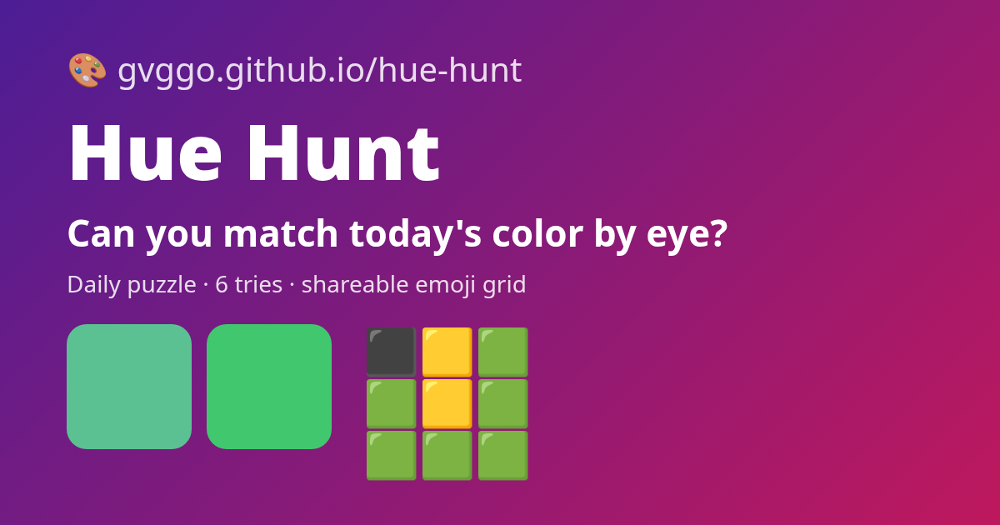

# 🎨 Hue Hunt

**A daily color-matching game. One mystery color a day, 6 tries, no numbers — just your eyes.**

▶ **Play:** https://gvggo.github.io/hue-hunt/



## How it plays
- Drag **Hue**, **Saturation** and **Lightness** sliders until your mix matches the target swatch.
- Every guess gets a match score (0–100%) and three tiles — 🟩 close, 🟨 near, ⬛ far — with arrows that tell you which way to move.
- Score **90%+** to win. Share an emoji grid like:
  ```
  Hue Hunt #1 3/6 🔥4
  ⬛🟨🟩 61%
  🟩🟨🟩 84%
  🟩🟩🟩 96%
  ```
- **Daily mode:** everyone gets the same color on the same local date (deterministic seed from the date). Streaks and stats are saved in your browser only.
- **Practice mode:** unlimited random colors that don't touch your streak.

## How it works
- Daily color = `mulberry32(FNV-1a("huehunt:" + YYYY-MM-DD))`, kept inside a playable range (saturation 35–95%, lightness 28–72%).
- Match score is based on the CIE76 color difference (ΔE) in CIELAB space, so it tracks how different colors *look*, not just how far the slider numbers are.
- Pure logic lives in `logic.js` (no DOM) and is unit-tested.

## Run locally
Open `index.html`, or `python3 -m http.server` in this folder. Tests: `node tests/logic.test.mjs`.

## Privacy
No backend, no analytics, no accounts. Stats live in `localStorage`.

## Tech
Vanilla HTML/CSS/JS · GitHub Pages. Built with AI assistance as a portfolio project.

## License
MIT
